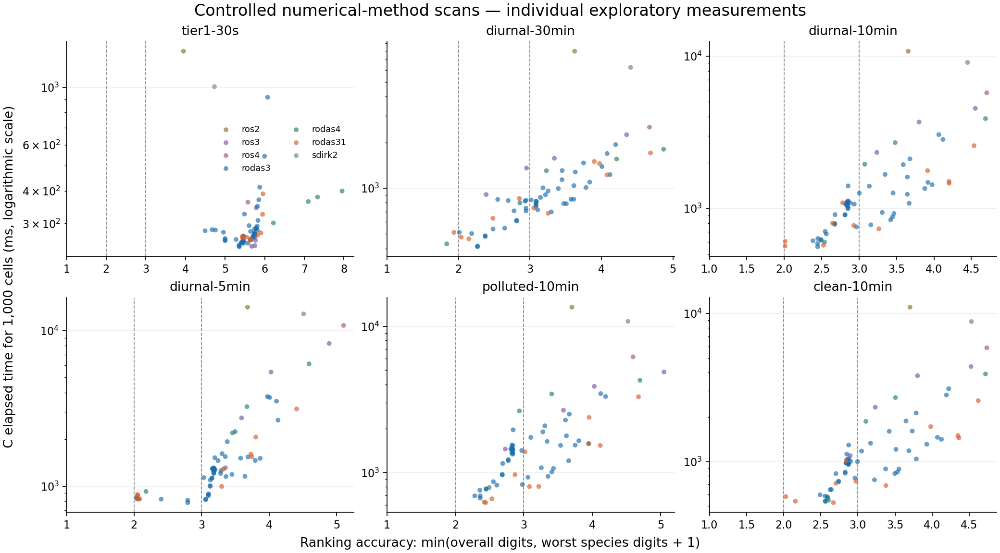
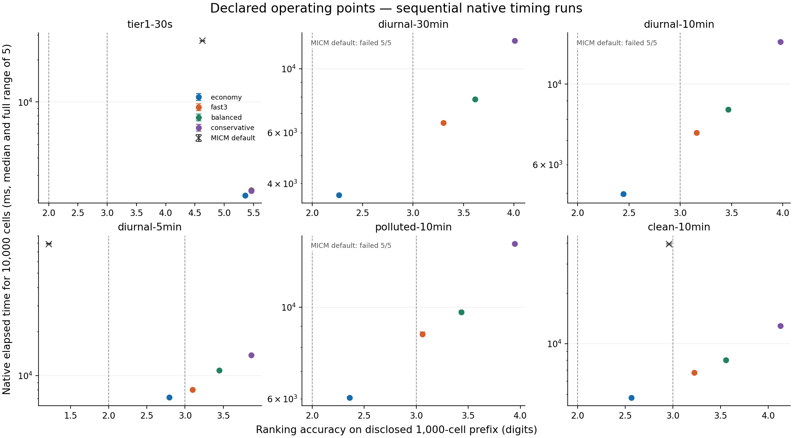

# Results

Tier 3 measurements on the supplied 10-core Apple M5, macOS 27.0.1. Native C uses clang 21 or GCC 15.2, ISO C11/OpenMP, and `OPTFLAGS="-O3 -DNDEBUG"`. MICM is compiled with clang++ and identical optimization flags. No target, fast-math, LTO, or profile flags are used.

## Declared operating points

All four points complete every disclosed scenario and all three independent 48-hour cases with nonnegative states and pass their indicated accuracy level. **Balanced is recommended** for its accuracy margin. Full commands are in [OPERATING_POINTS.md](OPERATING_POINTS.md).

| Point | Target level | Lowest overall digits, 9 cases | Lowest species digits | Geometric mean of six 10,000-cell median times (ms) |
| --- | ---: | ---: | ---: | ---: |
| economy | 2 | 2.266 | 1.271 | 4,475.6 |
| fast3 | 3 | 3.086 | 2.057 | 6,119.0 |
| balanced | 3 | 3.433 | 2.490 | 7,138.4 |
| conservative | 3 | 3.867 | 3.065 | 9,932.2 |

The geometric mean is a descriptive summary, not a claim about the experimenter’s undisclosed ranking aggregation. Accuracy uses full disclosed 1,000-cell cases and full 96-cell stress cases. The 10,000-cell runs are scored on the disclosed 1,000-cell prefix only; the C operating points’ full trajectories are checked for finite/nonnegative states by the native runner.

## Disclosed accuracy

Each entry is **overall / worst-species digits** from the supplied scorer.

| Scenario | economy | fast3 | balanced | conservative |
| --- | ---: | ---: | ---: | ---: |
| tier1-30s | 5.357 / 4.667 | 5.463 / 4.813 | 5.463 / 4.813 | 5.463 / 4.813 |
| diurnal-30min | 2.266 / 1.271 | 3.343 / 2.299 | 3.612 / 2.721 | 4.008 / 3.433 |
| diurnal-10min | 2.590 / 1.446 | 3.170 / 2.157 | 3.466 / 2.607 | 3.975 / 3.395 |
| diurnal-5min | 2.794 / 1.949 | 3.139 / 2.099 | 3.449 / 2.580 | 3.867 / 3.065 |
| polluted-10min | 2.456 / 1.362 | 3.086 / 2.060 | 3.433 / 2.509 | 3.947 / 3.199 |
| clean-10min | 2.622 / 1.562 | 3.224 / 2.259 | 3.553 / 2.667 | 4.125 / 3.349 |

## Native timing at 10,000 cells

Milliseconds, **median of five sequential runs**, ten requested threads. No build, native validation suite, or other solver benchmark from this repository was run concurrently. The C timer includes all steps and photolysis/rate updates, and excludes input, setup, diagnostics, snapshot copying and output. MICM uses its unchanged supplied timer, which also includes in-memory snapshot copying. These are local measurements; machine-wide idleness is not independently certified.

| Scenario | MICM default 3-stage | economy | fast3 | balanced | conservative |
| --- | ---: | ---: | ---: | ---: | ---: |
| tier1-30s | 27,279.4 | 2,167.2 | 2,363.9 | 2,345.3 | 2,335.6 |
| diurnal-30min | failed 5/5 | 3,642.1 | 6,494.8 | 7,835.0 | 12,532.5 |
| diurnal-10min | failed 5/5 | 4,975.3 | 7,340.3 | 8,513.1 | 13,092.4 |
| diurnal-5min | 78,927.6 | 7,116.6 | 8,031.8 | 10,847.4 | 13,768.4 |
| polluted-10min | failed 5/5 | 6,035.7 | 8,607.2 | 9,732.5 | 14,236.5 |
| clean-10min | 39,189.8 | 4,764.6 | 6,737.3 | 8,011.6 | 12,779.7 |

C uses groups of 32 cells with dynamic group scheduling. The MICM baseline uses its default one group per requested thread: 1,000 cells per group here, and 100 in the smaller comparison below. The implementations, grouping and adaptive policies therefore differ; this is a comparison against the supplied baseline, not an attribution of all time differences to the integration formula.

The default baseline fails on some long scenarios and does not meet the two-digit target on the 5-minute diurnal case. Consequently, its timings are not an equal-accuracy speed comparison, and no speedup is assigned to failed runs. For a robust three-stage baseline, scan 05 uses rtol `1e-5`, atol `1e-18`, and 100,000 maximum steps.

| 1,000-cell scenario | MICM default digits / worst | Tight MICM 3-stage ms | Tight overall / worst |
| --- | ---: | ---: | ---: |
| tier1-30s | 4.629 / 4.031 | 2,731.0 | 6.475 / 5.645 |
| diurnal-30min | failed | 5,803.0 | 5.142 / 4.066 |
| diurnal-10min | failed | 10,389.0 | 5.392 / 4.216 |
| diurnal-5min | 1.215 / 0.214 | 16,274.5 | 5.518 / 4.48 |
| polluted-10min | failed | 11,957.2 | 5.639 / 4.726 |
| clean-10min | 2.959 / 2.162 | 9,885.4 | 5.268 / 4.134 |

These tight-baseline times are single native observations and obtain more accuracy than the declared targets. Their purpose is to show a working MICM three-stage comparison alongside the default failures.

## Independent 48-hour cases

The new cases use 96 cells each: winter night at 60° N; summer at 65° N with NOx multiplied by 20; and tropical conditions at 10° S with NOx multiplied by 0.03. Seeds, forcing and reference hashes are in [validation/stress-references.json](validation/stress-references.json). Two tight six-stage references agree to 10.193–10.412 overall digits and at least 9.494 digits for every species.

| Scenario | economy | fast3 | balanced | conservative |
| --- | ---: | ---: | ---: | ---: |
| winter-night-48h | 2.7 / 1.868 | 3.505 / 2.934 | 3.692 / 3.147 | 3.981 / 3.477 |
| summer-polluted-48h | 2.842 / 2.003 | 3.41 / 2.544 | 3.72 / 2.872 | 4.232 / 3.441 |
| tropical-clean-48h | 3.158 / 2.058 | 3.163 / 2.057 | 3.601 / 2.49 | 4.249 / 3.162 |

## Projection and implementation checks

| Point | Largest individual projection (mol m-3) | Largest trajectory-total projection per cell, averaged across cells (mol m-3) |
| --- | ---: | ---: |
| economy | 9.976e-18 | 5.957e-18 |
| fast3 | 9.992e-20 | 1.001e-19 |
| balanced | 9.993e-20 | 8.184e-20 |
| conservative | 9.992e-20 | 7.729e-20 |

Projection totals sum concentration increments over species and accepted steps; they are not elemental mass balances. All indirect effects remain included in the scored trajectories.

Both compilers pass **all 680 named Tier 1 cases**, the native extension tests, 147 C/prototype comparisons with identical operation counts, seven stiff analytical cases, linear-chain order checks, failure/rejection tests, the projected SDIRK error regression, and the scenario I/O/forcing/thread contract. Every declared point also passes all nine accuracy cases with GCC.

- clang, small Tier 1 gate: PASS: 21100 values in 100 cells x 211 columns; largest relative difference 3.23e-14 (BCARY, cell 86) (rtol 1e-10, atol 1e-30)
- clang, large Tier 1 gate: PASS: 2110000 values in 10000 cells x 211 columns; largest relative difference 2.96e-13 (BCARY, cell 4179) (rtol 1e-10, atol 1e-30)
- gcc, small Tier 1 gate: PASS: 21100 values in 100 cells x 211 columns; largest relative difference 3.66e-14 (BCARY, cell 86) (rtol 1e-10, atol 1e-30)
- gcc, large Tier 1 gate: PASS: 2110000 values in 10000 cells x 211 columns; largest relative difference 2.75e-13 (BCARY, cell 4179) (rtol 1e-10, atol 1e-30)

Authoritative records: [compiler gates](validation/tier3-gates.json), [clang cases](validation/tier3-clang-cases.txt), [GCC cases](validation/tier3-gcc-cases.txt), and [scans/](scans/). The legacy implementation, configuration and all named cases are retained. Historical Tier 1 measurements are archived in [validation/TIER1_RESULTS.md](validation/TIER1_RESULTS.md). Linux was not available for execution; portability is supported by source inspection and the two supplied compilers on this host.

## Work–precision plots

The x coordinate includes the species constraint: `min(overall digits, worst-species digits + 1)`. Vertical lines mark levels 2 and 3. Exploratory scans show individual observations; final points and the MICM default baseline show five-run medians and full timing ranges. Failed baseline cases are labeled without assigning a time. The six exploratory observations known to overlap reference compilation and the six superseded SDIRK observations are omitted from the plot and remain in the raw scan logs. Scan 11 supplies the corrected SDIRK points.

Vector exports: [scan SVG](figures/work-precision-scans.svg), [operating-point SVG](figures/work-precision-operating-points.svg). Regenerate with `.conda/bin/python tools/plot_scans.py`.
