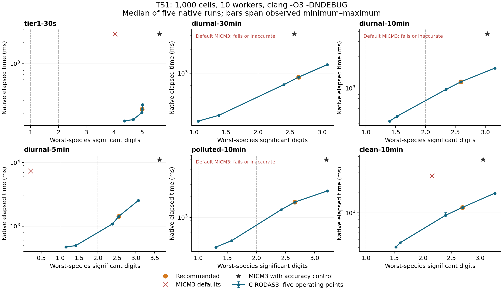

# Tier 3 results

Measurements use the supplied 10-core machine, clang 21 and GCC 15.2, with `OPTFLAGS=-O3 -DNDEBUG`. Numerical methods solve all 547 reactions and 209 variable species. Only native C/C++ clocks supply elapsed times. Setup, validation, and CSV writing are excluded. No benchmark jobs or compiler jobs overlap the final timing batches.

## Current validation

| Compiler | Tier 1 PASS | N/A | FAIL | Prototype comparisons | Maximum prototype difference | 100 / 10000-cell gate |
| --- | --- | --- | --- | --- | --- | --- |
| clang | 675 | 5 | 0 | 45 | 6.79e-14 | PASS |
| gcc-15 | 675 | 5 | 0 | 45 | 3.5e-14 | PASS |

Every one of the 680 supplied identifiers is audited, including all eight plain programs. The five N/A cases are the retained compile-time C++ category/SFINAE cases. `scans/tier1-*.csv` records each result. All new-method prototype operation counts agree exactly; the listed concentration differences are accumulated double-precision roundoff. Scenario interpolation, photolysis caching, partial groups, snapshots, schedule independence, forcing discontinuities, ownership, invalid settings, and stiff nonnegative transfer are checked. `scans/validation.json` contains commands/flags, hashes, and the supplied all-cell/all-species roundoff gates. All 30 operating-point/scenario combinations also pass their declared accuracy levels and output gate with GCC (`scans/final-gcc-1000.csv`); GCC times are individual validation observations.

## Operating-point accuracy

The following table uses all 1,000 disclosed cells and all reference snapshots. Each cell is `overall / worst-species` significant digits from the unmodified supplied scorer.

| Scenario | fast | balanced | accurate | recommended | precise |
| --- | --- | --- | --- | --- | --- |
| tier1-30s | 5.062 / 4.374 | 5.322 / 4.682 | 5.822 / 4.995 | 5.842 / 5.003 | 5.862 / 5.017 |
| diurnal-30min | 2.122 / 1.064 | 2.328 / 1.386 | 3.701 / 2.404 | 3.884 / 2.632 | 4.296 / 3.08 |
| diurnal-10min | 2.509 / 1.401 | 2.628 / 1.523 | 3.273 / 2.341 | 3.626 / 2.593 | 4.458 / 3.161 |
| diurnal-5min | 2.041 / 1.153 | 2.29 / 1.413 | 3.414 / 2.388 | 3.571 / 2.554 | 4.25 / 3.069 |
| polluted-10min | 2.401 / 1.305 | 2.566 / 1.578 | 3.344 / 2.425 | 3.759 / 2.663 | 4.428 / 3.217 |
| clean-10min | 2.413 / 1.528 | 2.644 / 1.603 | 3.299 / 2.398 | 3.665 / 2.696 | 4.422 / 3.261 |

All five points pass the nonfinite/negative gate on every run. `fast` and `balanced` meet level two on every disclosed scenario; the other three meet level three. `recommended` uses `rtol=3e-4`, 16-cell groups, and dynamic scheduling. `ACCURACY.md` explains the scientific target, primary-species diagnostics, and measured small-negative projections.

## Native elapsed time: 1,000 cells

Values are milliseconds, medians of five complete scenario runs. The independent MICM3 baseline uses its exact default controls, or `rtol=3e-4, atol=1e-18` for the accuracy-controlled column. MICM uses groups of 32; the selected C points use groups of 16 with dynamic scheduling. The comparison includes both the retained C implementation improvements and numerical-control changes.

| Scenario | fast | balanced | accurate | recommended | precise | MICM3 defaults | MICM3 controlled | Controlled / recommended |
| --- | --- | --- | --- | --- | --- | --- | --- | --- |
| tier1-30s | 156.5 | 162.7 | 204.6 | 228.5 | 264.8 | 2621.9 | 2637.9 | 11.55× |
| diurnal-30min | 250.5 | 296.0 | 720.4 | 893.5 | 1284.9 | FAIL | 3145.0 | 3.52× |
| diurnal-10min | 322.9 | 381.0 | 955.0 | 1245.1 | 1990.7 | 3660.7 | 6489.1 | 5.21× |
| diurnal-5min | 471.5 | 494.8 | 1088.1 | 1431.5 | 2530.0 | 7394.0 | 11137.0 | 7.78× |
| polluted-10min | 371.7 | 461.6 | 1294.6 | 1676.1 | 2425.8 | FAIL | 6924.9 | 4.13× |
| clean-10min | 305.5 | 354.9 | 916.0 | 1206.8 | 1970.5 | 3585.8 | 6288.6 | 5.21× |

A finite default MICM result is not necessarily accurate: the defaults fail on two scenarios, produce very inaccurate finite output on another, and miss level three on others. Default failures are not assigned a speedup. The controlled baseline qualifies at level three, but its achieved accuracy is generally higher than that threshold; ratios compare qualifying operating points rather than identical final errors.




Each curve uses measured median C time; bars show the observed minimum–maximum range. Dashed lines show the ranking thresholds. SVG versions are available beside the PNGs. The worst-species figure is necessary because the overall score alone is insufficient.

## Native elapsed time: 10,000 cells

These are independently measured complete 10,000-cell extensions, again medians of five native runs. All output values pass the gate. Relative-error scores cover the first 1,000 cells, which the generator verifies match the supplied inputs exactly; there is no claim of tight-reference accuracy for the remaining 9,000 cells.

| Scenario | fast | balanced | accurate | recommended | precise | MICM3 defaults | MICM3 controlled | Controlled / recommended |
| --- | --- | --- | --- | --- | --- | --- | --- | --- |
| tier1-30s | 1528.8 | 1580.6 | 2003.2 | 2192.5 | 2499.7 | 22505.6 | 23306.2 | 10.63× |
| diurnal-30min | 2564.1 | 2980.4 | 7478.5 | 8719.8 | 12112.5 | FAIL | 27755.0 | 3.18× |
| diurnal-10min | 3208.5 | 3781.0 | 9859.2 | 12185.8 | 18372.0 | FAIL | 57908.7 | 4.75× |
| diurnal-5min | 4651.7 | 4902.5 | 10962.2 | 13537.7 | 23025.2 | 64499.3 | 100399.3 | 7.42× |
| polluted-10min | 3786.3 | 4641.5 | 12881.8 | 15466.1 | 22123.0 | FAIL | 61642.7 | 3.99× |
| clean-10min | 2994.5 | 3493.2 | 8706.4 | 11181.0 | 18081.3 | 31704.0 | 57497.8 | 5.14× |

Full per-run times, counters, output hashes, and measured accuracy are in `scans/final-clang-10000.csv`. The MICM columns are individual native C++ observations, not five-run medians; `scans/micm-large.csv` records those comparisons. Its defaults fail on three large scenarios. Ratios therefore compare a single controlled baseline observation with a C median. The experimenter supplies the authoritative idle-machine medians and hidden-scenario scores.

## Additional 48-hour validation

Three locally generated 64-cell cases vary seed, latitude, season, duration, step length, and NOx. Their MICM6 references at `rtol=1e-10, atol=1e-23` agree with looser independent runs by more than ten overall digits and nine worst-species digits. These are additional tests, not hidden experimenter inputs. Every declared point passes the gate.

| Scenario | fast | balanced | accurate | recommended | precise |
| --- | --- | --- | --- | --- | --- |
| clean-winter-48h-5min | 2.777 / 1.951 | 2.778 / 1.951 | 3.562 / 2.55 | 3.717 / 2.735 | 4.588 / 3.613 |
| polluted-48h-10min | 2.736 / 1.623 | 2.791 / 1.687 | 3.582 / 2.783 | 3.962 / 3.112 | 4.833 / 3.682 |
| summer-48h-30min | 2.249 / 1.272 | 2.45 / 1.611 | 3.664 / 2.667 | 3.944 / 2.9 | 4.407 / 3.367 |

`scans/stress-scenarios.json` and `tools/stress_references.py` reproduce these inputs and their reference-convergence checks. The recommended point also clears the stated accuracy target on these longer, different-regime tests.

## Reproduction

```sh
make env
make bench CC=clang
.conda/bin/python tools/large_scenarios.py
.conda/bin/python tools/scan.py scans/operating-points-throughput.json --study local-small --repeats 5 --metrics
.conda/bin/python tools/scan.py scans/operating-points-throughput.json --study local-large --scenario-root results/large --repeats 5
make micm-scenario
.conda/bin/python tools/scan.py scans/micm-baselines.json --study local-micm --backend micm --compiler clang++ --repeats 5
.conda/bin/python tools/validate.py
```

Use fresh study names for changed code/options. The supplied input directories remain read-only. `SCANS.md`, `REFERENCES.md`, and `scans/README.md` give the controlled comparisons, provenance, schema, and caveats. `tools/report.py` regenerates this report from the committed final study names. Historical Tier 1 measurements are retained in `RESULTS_TIER1.md`; the validation above is current.
