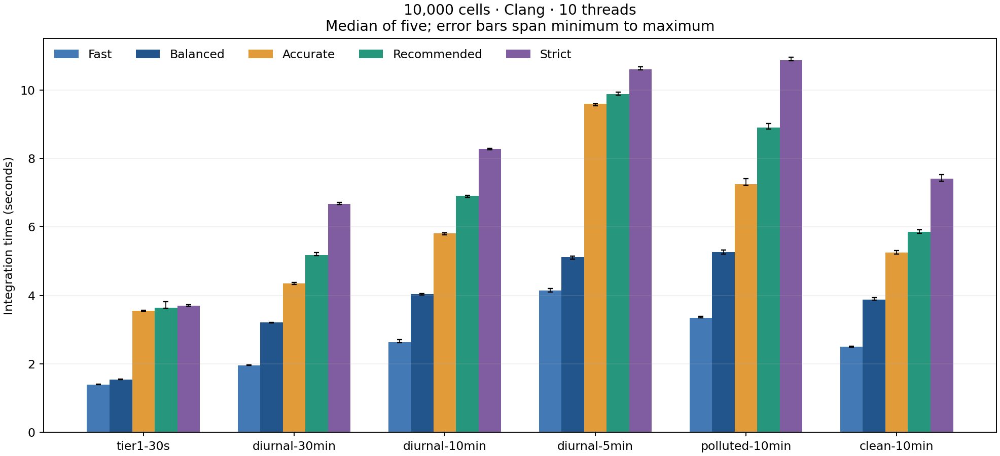
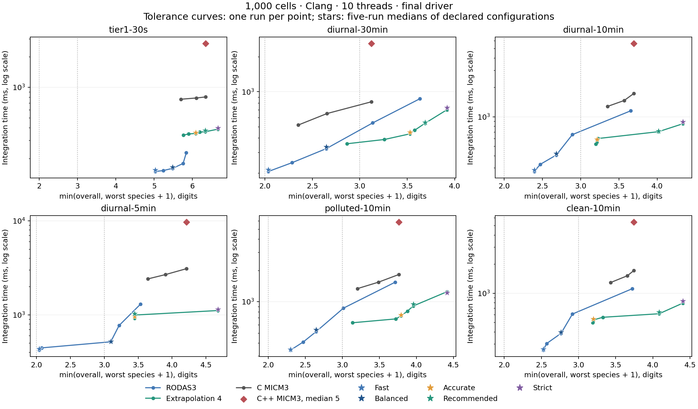
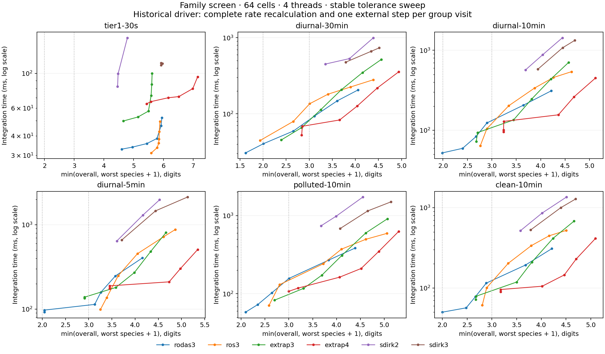

# Accuracy and performance

Fourth-order linearly implicit Euler extrapolation at `rtol=0.002`, `atol=1e-18`
is the recommended atmospheric-model configuration. It exceeds the target of
three overall digits and two digits for every scored species on every disclosed
case and on the additional 48-hour stress cases. RODAS3 provides cheaper
configurations for the two-digit tier. All five declared points pass their
intended level and finite/nonnegative gate in the final measurements.

## Scope and measurement

Measurements use the supplied 10-core Apple M5 host, macOS 27.0.1, Apple Clang
21.0.0 and GCC 15.2.0. All C objects use `-O3 -DNDEBUG -std=c11`, the documented
warnings/includes, and OpenMP. The supplied C++ MICM runner uses clang++ with
`-O3 -DNDEBUG -std=c++20`. No architecture, floating-point, LTO or profiling
flags are added. All reported times come from the compiled executables' internal
integration timers, including forcing/rate updates and validation, excluding
setup and CSV I/O. There is no scenario warm-up.

Final Clang measurements use ten threads and five serialized repetitions for
every configuration/scenario. No other benchmark or build from this task runs
concurrently; unrelated machine load is uncontrolled. Medians are local evidence,
not a promise of the evaluator's idle-machine timing. Each repetition has
bit-identical output and work counts within its configuration/scenario. Reused
scores require identical output SHA-256 and the same reference/level.

The original six disclosed inputs contain 1,000 cells each. The 10,000-cell
inputs reproduce their recipes and have a verified identical first 1,000 cells.
**Accuracy at 10,000 cells is measured only on that reference prefix.** The
finite/nonnegative gate covers all 10,000 cells, and the C runner checks every
external step for every cell. The larger input changes the grouping of the final
eight cells of the reference prefix, so prefix scores need not be identical.
The remaining 9,000 trajectories have no independent accuracy reference here.
No experimenter's withheld scenario was available.

## Declared points

The following accuracies are minima across the six scenarios, independently for
overall and worst species. Times sum the six per-scenario medians; this equal
weight summary is not an official ranking aggregate. Full commands and expected
levels are in [OPERATING_POINTS.md](OPERATING_POINTS.md).

| Point | Overall, 1k | Species, 1k | Overall, 10k prefix | Species, 10k prefix | Sum seconds, 1k | Sum seconds, 10k |
| --- | --- | --- | --- | --- | --- | --- |
| Fast | 2.041 | 1.035 | 2.041 | 1.035 | 1.702 | 15.972 |
| Balanced | 2.645 | 1.646 | 2.645 | 1.647 | 2.376 | 23.053 |
| Accurate | 3.201 | 2.390 | 3.201 | 2.390 | 3.648 | 35.796 |
| Recommended | 3.448 | 2.550 | 3.448 | 2.550 | 4.249 | 40.364 |
| Strict | 4.064 | 2.919 | 4.065 | 2.919 | 5.208 | 47.520 |

### Per-scenario accuracy at 1,000 cells

Each entry is overall / worst-species digits. C++ MICM3 has the same rounded scores as the C compatibility baseline.

| Scenario | Fast | Balanced | Accurate | Recommended | Strict | C MICM3 |
| --- | --- | --- | --- | --- | --- | --- |
| tier1-30s | 5.029 / 4.310 | 5.486 / 4.836 | 6.085 / 5.497 | 6.334 / 5.814 | 6.663 / 6.066 | 6.348 / 5.619 |
| diurnal-30min | 2.102 / 1.035 | 2.739 / 1.646 | 3.670 / 2.529 | 3.824 / 2.689 | 4.064 / 2.919 | 3.338 / 2.124 |
| diurnal-10min | 2.527 / 1.393 | 2.728 / 1.681 | 3.213 / 2.390 | 4.196 / 3.015 | 4.562 / 3.334 | 3.924 / 2.693 |
| diurnal-5min | 2.041 / 1.153 | 3.162 / 2.096 | 3.448 / 2.550 | 3.448 / 2.550 | 4.824 / 3.674 | 4.214 / 3.353 |
| polluted-10min | 2.401 / 1.300 | 2.645 / 1.729 | 3.927 / 2.794 | 4.137 / 2.959 | 4.578 / 3.412 | 3.918 / 2.765 |
| clean-10min | 2.537 / 1.525 | 2.765 / 1.792 | 3.201 / 2.501 | 4.243 / 3.084 | 4.553 / 3.403 | 3.887 / 2.744 |

### 1,000 cells: per-scenario median milliseconds

| Scenario | Fast | Balanced | Accurate | Recommended | Strict | C MICM3 | C++ MICM3 |
| --- | --- | --- | --- | --- | --- | --- | --- |
| tier1-30s | 154.4 | 164.3 | 358.4 | 377.0 | 396.9 | 819.1 | 2704.6 |
| diurnal-30min | 213.9 | 336.6 | 447.5 | 543.8 | 729.9 | 818.4 | 2602.1 |
| diurnal-10min | 286.7 | 419.6 | 587.8 | 716.5 | 885.7 | 1773.4 | 5640.1 |
| diurnal-5min | 433.3 | 520.8 | 961.9 | 1026.7 | 1145.8 | 3116.2 | 9694.2 |
| polluted-10min | 348.2 | 539.2 | 747.2 | 948.1 | 1221.4 | 1856.3 | 5844.0 |
| clean-10min | 265.3 | 395.4 | 544.9 | 637.2 | 828.4 | 1718.0 | 5431.0 |

### 10,000 cells: per-scenario median milliseconds

| Scenario | Fast | Balanced | Accurate | Recommended | Strict |
| --- | --- | --- | --- | --- | --- |
| tier1-30s | 1390.8 | 1541.3 | 3552.5 | 3639.3 | 3694.2 |
| diurnal-30min | 1960.3 | 3212.0 | 4348.6 | 5181.2 | 6673.8 |
| diurnal-10min | 2629.7 | 4041.4 | 5808.7 | 6899.9 | 8277.2 |
| diurnal-5min | 4141.7 | 5124.5 | 9595.6 | 9877.2 | 10595.3 |
| polluted-10min | 3348.6 | 5261.2 | 7240.8 | 8905.6 | 10871.3 |
| clean-10min | 2500.5 | 3872.7 | 5249.6 | 5860.8 | 7408.3 |

### Work on the six 1,000-cell scenarios

Totals count group operations in one repetition of each scenario, with 32-cell groups and an eight-cell tail. Rate evaluations are a separate per-cell counter in the CSV. Extrapolation spends more factorizations per trial but accepts larger steps.

| Point | Trials | Forcing | Jacobians | LU | Solves |
| --- | --- | --- | --- | --- | --- |
| Fast | 44,065 | 128,651 | 40,521 | 44,065 | 176,260 |
| Balanced | 63,444 | 181,483 | 54,595 | 63,444 | 253,776 |
| Accurate | 39,001 | 271,426 | 37,420 | 156,004 | 390,010 |
| Recommended | 45,160 | 313,923 | 42,963 | 180,640 | 451,600 |
| Strict | 54,755 | 379,446 | 50,916 | 219,020 | 547,550 |
| C MICM3 | 366,077 | 714,451 | 366,077 | 366,077 | 1,098,231 |

## MICM comparison and work–precision

The unchanged MICM3 defaults remain available. On the disclosed long runs their
`atol=1e-3` is too loose: the default fails on the 30-minute diurnal and polluted
cases and misses level three on other cases. Those runs remain in
`scans/baselines1000.csv`; their speed is not used as an accuracy-qualified baseline.
The original C and supplied C++ MICM3 solvers agree in their measured accuracy
when given matching explicit tolerances and group size.

The repeated matched baseline uses `rtol=0.001`, `atol=1e-18`, group size 32 and
100,000 maximum attempts. It passes level three on all six disclosed scenarios.
Looser tested MICM3 tolerances 0.003 and 0.01 do not pass that across-scenario
criterion. This is the fastest qualifying MICM3 setting in the tested grid,
not a proof that no intermediate tolerance would improve it. The C baseline
uses the same rate cache and scheduling as the new solvers; the supplied C++
runner is unchanged. Thus C-to-C speed ratios more directly isolate integrator
and adaptive-control changes, while C++ ratios also include library and driver
differences.

The **accurate** point is 2.77× faster than the C MICM3 baseline and 8.75× faster than C++ MICM3 by summed scenario medians.

The **recommended** point is 2.38× faster than the C MICM3 baseline and 7.51× faster than C++ MICM3 by summed scenario medians.

The horizontal criterion is `min(overall digits, worst-species digits + 1)`;
reaching L is equivalent to the combined accuracy requirement. Curves follow
local tolerances, so nonmonotone segments are meaningful. Curves use single
runs with the final implementation; stars show the five-run declared-point
medians. C++ MICM3 is shown at the matched qualifying tolerance.

The 64-cell plot is the stable-build repetition of the tolerance screen. It uses
the historical driver before constant-rate caching and blocking; do not compare
its absolute times with the final driver plot. It shows why SDIRK2/3 and lower
extrapolation order were not selected. [SCANS.md](SCANS.md) describes controlled
structural comparisons, unsuccessful variants and provenance limitations.

## Stress tests and accuracy limits

The additional summer/winter/tropical 48-hour cases use 128 cells and different
seeds, forcing and pollution. Tight/tighter six-stage MICM references agree by
at least 10.230 overall digits and 9.483 worst-species digits. They informed
selection: the previously considered extrapolation `rtol=0.006` failed in the
tropical case and was replaced by `0.004`. These are stress tests, not untouched
holdouts. The table reports minima across all three cases and both compilers.

| Point | Overall digits | Worst-species digits | Intended level |
| --- | --- | --- | --- |
| Fast | 2.177 | 1.186 | L2: PASS |
| Balanced | 2.683 | 1.796 | L2: PASS |
| Accurate | 3.753 | 2.693 | L3: PASS |
| Recommended | 3.929 | 2.848 | L3: PASS |
| Strict | 4.126 | 3.051 | L3: PASS |

The recommended point has a largest individual scored relative error of 0.998% (N2O5, diurnal-10min), illustrating that an RMS criterion is not a pointwise bound. All-species RMS and maximum errors are retained in `results/species_accuracy.csv`.

| Species | Minimum digits across six cases | Maximum individual relative error |
| --- | --- | --- |
| O3 | 5.763 | 0.000468% |
| OH | 2.922 | 0.683% |
| HO2 | 2.837 | 0.74% |
| NO | 2.707 | 0.623% |
| NO2 | 4.901 | 0.0177% |
| H2O2 | 5.425 | 0.00182% |

Projection is measured and charged to the local error norm, but does not exactly
preserve elemental invariants. A deliberately stiff conservative test documents
that effect; [ACCURACY.md](ACCURACY.md) states the budget and its limits. Reference
values below `1e-14 mol m-3` are excluded from the relative score but remain in
the chemistry and finite/nonnegative gate. The results do not bound unrecorded
instantaneous peaks or establish accuracy for every possible mechanism.

## Compatibility and verification

Both compilers pass all 680 original tests, with exactly the supplied case list
and no N/A entries, plus all nine original TS1 agreement variants at relative
`1e-10`. Both pass 44 independent prototype comparisons with matching operation
counts, ten fixed-order convergence checks, scalar/group equivalence, stiff
and invalid-input tests, generic rate-dependency tests, and scenario I/O tests.
The latter check photolysis interpolation/snapshots against MICM, generated versus
generic kernels, and bit-identical cache/block/schedule variants. New methods
are additions; the original solver formulas and mechanism remain unchanged.

The prototype uses independent dense operations and chemistry, sharing only the
explicitly disclosed ROS coefficient tables. Maximum C/prototype absolute
solution differences are below 128 double epsilons. Transcripts, coefficient
agreement results, orders and final executable hashes are in
`results/validation-clang/` and `results/validation-gcc/`. Every selected point
also passes its intended accuracy level with GCC on all disclosed and stress
cases. Portability is checked with both compilers on this host; Linux execution
was unavailable and is not claimed.

## Reproduction and evidence

`tools/validate.py --compiler clang` (or `gcc-15`) runs and records the compiler
gates. `tools/scan.py scans/final_comparison.json --scan NEW_NAME --repeats 5`
repeats the 1,000-cell comparison. Generate larger inputs with `tools/scaling.py`
and use `--scenario-root build/scaling` with `scans/operating_points.json`.
Always use `.conda/bin/python`, run scans sequentially, and do not rebuild during
measurements. `--discard-repeats --reuse-identical-scores` saves disk space while
retaining every timing/log and the first state of each configuration/scenario.

`results/operating_summary.csv` contains medians, ranges, accuracy and work;
`scans/` retains every configuration and raw measured row, including failures.
`results/disclosed_inputs.json` records hashes of the supplied inputs and
references; the scaling and stress manifests record their generated inputs.
`tools/report.py` regenerates this report, operating points, and PNG/SVG figures.
It recomputes species diagnostics when raw outputs exist; otherwise it uses the
retained diagnostics after checking their output hashes against the final scan.
The historical Tier 1 measurements are preserved separately in
[results/tier1_results.md](results/tier1_results.md); their workload includes a
warm-up and differs from the new scenario timer.
