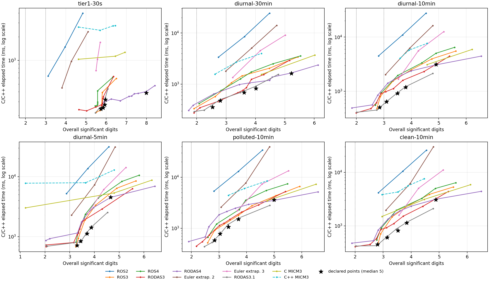
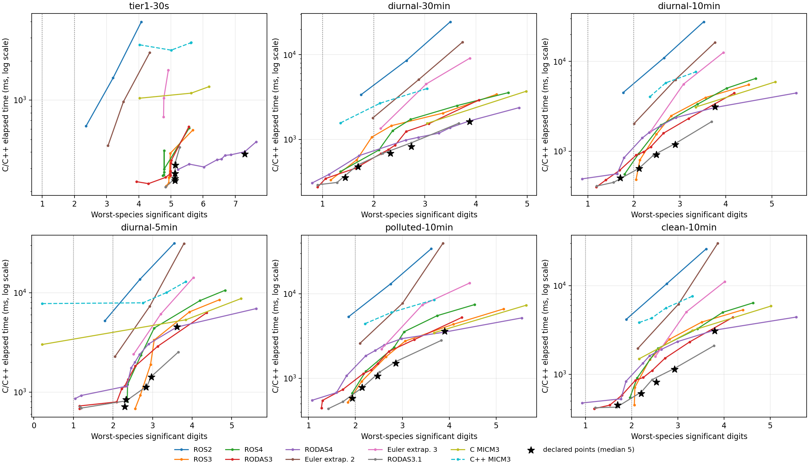

# Tier 3 results

Five operating points pass their declared accuracy levels on every disclosed
scenario with both compilers, and on three independent 48-hour cases. The
recommendation uses RODAS3.1 with rtol=3e-4 and atol=1e-18 mol/m3. It retains
a current Jacobian at every accepted step and solves the complete mechanism.
See OPERATING_POINTS.md for exact commands, ACCURACY.md for the error budget,
and SCANS.md / scans/ for controlled experiments and raw records.

## Accuracy

Digits are from the unmodified supplied score.py. Each entry below is the
minimum over scenarios, not the score of an average state. All state values
pass the finite/nonnegative gate. The last columns use independent references
for high-latitude summer, winter and equatorial 48-hour conditions.

| Point | Declared level | Disclosed overall | Disclosed worst species | 48-hour overall | 48-hour worst species |
|---|---:|---:|---:|---:|---:|
| L2 | 2 | 2.541 | 1.445 | 2.532 | 1.709 |
| L2_margin | 2 | 2.799 | 1.689 | 2.874 | 1.982 |
| L3 | 3 | 3.341 | 2.322 | 3.568 | 2.840 |
| recommended | 3 | 3.705 | 2.734 | 3.923 | 3.194 |
| L4 | 4 | 4.657 | 3.614 | 5.309 | 4.483 |

The additional references agree under tolerance refinement by 10.076–10.349
digits overall and at least 8.992 digits per species. Their settings, work
and convergence are recorded in scans/stress-reference-*.csv and
scans/stress_conditions.json. This tests additional conditions and horizon;
it does not prove a uniform error bound on undisclosed inputs.

## C timings on disclosed 1000-cell scenarios

Apple clang 21, -O3 -DNDEBUG, ten threads, groups of 32, guided scheduling
with minimum chunk 1. Numbers are median milliseconds from five sequential
runs in a deterministic shuffled order. No other CPU-heavy task processes
ran during these measurements. Input, setup, snapshot copying and CSV output
are excluded; rate updates, all chemistry steps and returned-state checks
are included. Python provides no timing measurements.

| Scenario | L2 | L2_margin | L3 | recommended | L4 | MICM3 tuned for level 3 |
|---|---:|---:|---:|---:|---:|---:|
| tier1-30s | 242.6 | 251.4 | 273.7 | 318.2 | 387.5 | 2749.4 |
| diurnal-30min | 355.7 | 476.6 | 686.5 | 825.1 | 1622.0 | 2680.6 |
| diurnal-10min | 506.8 | 642.8 | 915.7 | 1187.5 | 3140.0 | 5780.0 |
| diurnal-5min | 713.4 | 836.8 | 1119.7 | 1415.3 | 4516.2 | 10033.5 |
| polluted-10min | 578.6 | 779.9 | 1066.6 | 1512.9 | 3615.8 | 6008.2 |
| clean-10min | 447.6 | 604.0 | 812.7 | 1138.2 | 3083.5 | 5588.1 |

The comparison baseline is the independently compiled, unmodified supplied
C++ MICM three-stage scenario runner, with the same OPTFLAGS and groups of
32. Its level-3 setting is rtol=1e-3, atol=1e-18; its level-2 setting is
rtol=1e-2, atol=1e-18. Each baseline time is a median of three runs. Both
settings meet the corresponding level on all six scenarios.

Against these tested baselines, L2 is 4.42–11.08 times faster, L3 is 3.90–10.04 times faster,
and the recommendation is 3.25–8.64 times faster. These ratios combine the retained Tier 1
C implementation improvements with the new numerical choices; they are not
pure method-only speedups. SCANS.md and the C controls separate those effects.
The supplied C++ runner also retains its own scheduling and snapshot buffering.
These are local development measurements, not the evaluator’s 10000-cell
median-of-five ranking.

## Original default baseline

The required default MICM3 method/tolerances remain available. Its atol=1e-3
mol/m3 does not provide acceptable long-run accuracy. With groups of 32 the
fresh C++ baseline gives:

| Scenario | Overall digits | Worst-species digits | C++ elapsed ms / status |
|---|---:|---:|---|
| tier1-30s | 4.629 | 4.031 | 2651.551 |
| diurnal-30min | — | — | solver failure |
| diurnal-10min | -7.63 | -8.647 | 3844.292 |
| diurnal-5min | 1.215 | 0.214 | 7763.236 |
| polluted-10min | — | — | solver failure |
| clean-10min | 2.959 | 2.162 | 3826.153 |

Different group norms explain differences from the supplied README’s
100-cell groups. Failed/inaccurate default runs are not used as an
accuracy-qualified speed baseline. The tighter rtol=1e-4 baseline is also
recorded in scans/micm-tight.csv.

## Scaling

Each point additionally runs all 10000 cells of the diurnal-10min scenario
without nonfinite or negative output. The accuracy score covers only the
disclosed first 1000 cells, whose input prefix is verified exactly; it is
**not** a full 10000-cell reference comparison. The gate covers all 10000
cells, and the C driver checks every returned external-step state.

| Point | C elapsed ms, one run | First 1000 overall digits | First 1000 worst species |
|---|---:|---:|---:|
| L2 | 4477.9 | 2.843 | 1.708 |
| L2_margin | 5809.1 | 3.098 | 2.112 |
| L3 | 8068.1 | 3.502 | 2.492 |
| recommended | 10729.4 | 3.796 | 2.901 |
| L4 | 28423.2 | 4.902 | 3.765 |

Grouping/scheduling development trials are in scans/scale.csv; full point
runs are in scans/scale-points.csv. All disclosed timings and operation
counts are in scans/operating-points.csv. Counts sum over groups, not cells.
Every one of the five repeats has identical scores and operation counts
for the same point/scenario.

## Work–precision plots

Curves show C development scans; stars are the declared-point median-of-five
timings. Failed runs and negative digit values remain in CSV records but are
omitted from these plots. The species plot prevents pooled RMS from hiding
a weak component.

Vector exports are plots/work_precision.pdf and plots/work_precision_species.pdf.
Recreate both with `.conda/bin/python tools/plot_scans.py`.

## Retained Tier 1 gate and portability

| Check | clang | GCC 15.2 |
|---|---:|---:|
| Exact case manifest | 680 IDs | 680 IDs |
| Runtime/numerical PASS | 675 | 675 |
| FAIL | 0 | 0 |
| Existing C++-only N/A | 5 | 5 |
| TS1, 100 cells, maximum relative difference | 0 | 3.27e-14 |
| TS1, 10000 cells, maximum relative difference | 0 | 1.43e-13 |
| Eight-method strict C/prototype comparisons | 48 PASS | 48 PASS |
| Exact forcing-cache comparisons | 64 PASS | 64 PASS |
| Linear/nonlinear analytic order and invariants | PASS | PASS |
| All declared points, all six disclosed cases | PASS | PASS |

The TS1 comparisons inspect every cell/species at 1e-30 + 1e-10 relative;
the 10000-cell reference is a fresh independent MICM run of the same full
input, not a prefix or pooled-error check. GCC point records are in
scans/operating-points-gcc.csv. The five exclusions and historical Tier 1
timing/group-size studies are retained in TIER1_RESULTS.md.

Address/undefined-behavior sanitizer checks pass the new analytic methods,
all eight method probes with reuse, and the scenario/partial-group driver
tests. A source audit finds no forbidden intrinsics, target extensions or
long double. The release C executable links only the system C/math runtime
and OpenMP; Python and reference C++ are absent. No optimization flags are
added beyond caller OPTFLAGS.

Aggressive H211b b=1 has documented roundoff sensitivity in independent
prototype comparisons; none of the declared points uses it or approximate
Jacobian reuse. No uniform error guarantee on unobserved conditions or
performance claim for untested integrator families is made.
